 

 

## About

I'm a B.Tech CSE (AI & ML) undergraduate at CMR Institute of Technology, Hyderabad, who enjoys building things end to end, from the model and its evaluation to the API and interface around it.

I led a CNN-based deepfake detection project, completed an AI Mentorship Internship at Technook, and built full-stack and embedded projects along the way. Python is my primary language, with strong fundamentals in OOPs, DBMS, operating systems and computer networks underneath it all.

Open to relocation, flexible shift timings, and training across emerging technology domains.

 

## Projects

| Project | What it does | Built with |
|:--|:--|:--|
| **Deepfake Detection** Team Leader · 2025–26 | Led the full lifecycle of a CNN-based detection system, grounded in a review of 112 papers where CNN architectures (XceptionNet, ResNet, VGG) averaged **89.73%** accuracy and ensembles reached **99.65%** | Python, TensorFlow, Keras, OpenCV |
| **Crypto Marketplace** Full-Stack · 2024 | Real-time analytics platform with live CoinGecko prices, TradingView charts and a RESTful API layer on MongoDB | React.js, Node.js, Express.js, MongoDB |
| **Human Following Robot** Embedded · 2024 | Autonomous robot using ultrasonic and IR sensor fusion for real-time human detection, driven by C/C++ logic through an L293D motor driver, with full hardware circuit design | Arduino Uno, C/C++, L293D |

 

## Tech Stack

<b>Languages</b> 

  
<b>Web / Full-Stack</b> 

  
<b>ML / AI</b> 

  
<b>Tools</b> 

  

**CS Fundamentals:** OOPs · DBMS (SQL, keys, normalization) · Operating Systems (processes, scheduling, deadlocks) · Computer Networks (TCP/UDP, HTTP/HTTPS) · DSA (arrays, strings, stacks, queues, hashmaps, recursion)

 

## Experience & Education

| | |
|:--|:--|
| **May – Jun 2024** | **AI Mentorship Intern, Technook (Hyderabad)**: built and evaluated AI/ML models, implemented preprocessing pipelines (cleaning, normalization, feature engineering) and assessed them with accuracy, precision, recall and F1-score |
| **2022 – Present** | B.Tech CSE (AI & ML), CMR Institute of Technology, Hyderabad |
| **2020 – 2022** | Intermediate (MPC), Sri Chaitanya Junior Kalashala · 85.4% |
| **2019 – 2020** | SSC, Bhashyam High School · 10.0 CGPA |
| **Certified** | AI Mentorship Internship (Technook), 7-Day ML Bootcamp (Google DSC × TensorFlow UG Hyderabad), Entrepreneurship Orientation Program |

 

